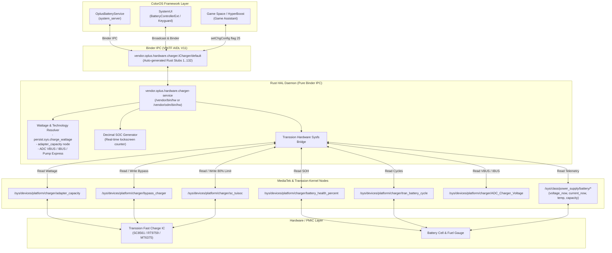

# OPlus Charger AIDL HAL Bridge for Transsion / MediaTek Devices

High-performance Rust AIDL HAL adapter implementing `vendor.oplus.hardware.charger.ICharger` (V11, 132 methods) for ColorOS, OxygenOS, and RealmeUI (Android 14+) ported to MediaTek & Transsion devices (specifically Tecno, Infinix, and itel running on MT6789 / Helio G99 and Dimensity SoCs).

---

## Overview

Stock ColorOS relies on proprietary OPlus hardware controllers (VOOC MCU / charge pumps) and kernel interfaces (`/dev/oplus_chg`, `/sys/class/oplus_chg/*`). When running ColorOS ports on non-OPlus hardware, the stock charger service fails to read hardware telemetry, causing:

1. **Absence of SuperVOOC / VOOC charging animations** across lockscreen and notification bar.
2. **Inability to trigger dynamic wattage display** (stuck at 10W default USB charging or failing to trigger on newer AIDL V11/V12 versions).
3. **Non-functional Game Space Bypass Charging**.
4. **Broken 80% charge protection limit and Battery Health (SOH) reporting**.

This HAL adapter is written in **memory-safe Rust** utilizing `rsbinder` to directly interface with Android's Binder IPC (`/dev/binder`). It bridges MediaTek / Transsion hardware kernel sysfs nodes into the official ColorOS AIDL Binder contract, restoring full UI animations, lockscreen decimal counters, and battery management features without modifying framework JAR files.

---

## Architecture Diagram



---

## Implemented Features

### 1. Accurate SuperVOOC Detection & Dynamic Wattage
* **Hierarchical Protocol Classification:**
  - **Normal / Standard Charging (SDP / CDP / 5V USB <= 10W):** Reports `mChargerTechnology = 0`, `mFastChgType = 0`, `mIsSupSpeedCharge = 0`, and `uiIconType = 1`. SuperVOOC animation is **never** triggered on slow USB or generic 5V chargers.
  - **Fast Charging (15W - 27W, e.g. QC/PD/PE 18W):** Reports `mChargerTechnology = 2` (VOOC / Fast), `mFastChgType = 1`, `fastCharge = 1`, and `uiIconType = 1`.
  - **Real SuperVOOC (>= 30W, e.g. 33W, 45W, 68W, 70W, 120W):** Triggered when hardware negotiated capacity is >= 30W or direct charge pump (`primary_dvchg`) is active. Reports `mChargerTechnology = 3`, `mFastChgType = 2`, `mIsSupSpeedCharge = 1`, and `uiIconType = 2`.
* **Hardware Telemetry Sources:**
  1. User property override (`persist.sys.charge_wattage` / `persist.sys.oplus.charge_wattage` / `persist.sys.rianixia.charge-wattage`).
  2. `/sys/devices/platform/charger/adapter_capacity` (hardware negotiated adapter rating).
  3. `/sys/class/power_supply/tran-auto-test/ta_power` (Transsion travel adapter wattage).
  4. Real-time VBUS (`ADC_Charger_Voltage` >= 8000 mV) & charge pump (`primary_dvchg/present`).

### 2. Lockscreen Decimal Percentage Animation
* Implements `healthd_update_ui_soc_decimal`.
* Returns high-precision animated decimal counter (e.g. `48.23%`) while SuperVOOC charging is active on the lockscreen.

### 3. Bypass Charging (Direct Power Supply)
* Bridges ColorOS Game Space / HyperBoost bypass charging toggles (`setChgConfig` flag 25) directly to `/sys/devices/platform/charger/bypass_charger`.
* When enabled, current bypasses the battery cell to power the motherboard directly, minimizing heat during gaming.

### 4. 80% Battery Protection Limit
* Bridges ColorOS Battery Protection (`setChgConfig` flag 14 / 5) to MediaTek `/sys/devices/platform/charger/sc_tuisoc`.
* Automatically sets kernel target charging limit to 80% when enabled, and restores 100% when disabled.

### 5. Battery Health (SOH) & Cycle Counter
* Maps `/sys/devices/platform/charger/battery_health_percent` to `getUIsohValue` and `getChgConfig` flag 58.
* Maps `/sys/devices/platform/charger/tran_battery_cycle` to `getChgConfig` flag 20 and `getPsyBatteryPchgResetCount`.

---

## AIDL Interface Contract

| Method Name | Payload / Return | Target Sysfs Node / Logic |
| :--- | :--- | :--- |
| `getAcType` | `1` (Online) / `0` (Offline) | `/sys/class/power_supply/charger/online` |
| `getBattAuthenticate` | `1` (Authentic) | Authentic battery verification |
| `getBattPPSChgIng` | `1` / `0` | PPS / Fast charging state |
| `getBattPPSChgPower` | Wattage integer (e.g. `33`) | Resolved adapter power |
| `getBattVoocChgIng` | `1` / `0` | SuperVOOC active state |
| `getBatteryVoltageNow` | Voltage in mV | `/sys/class/power_supply/battery/voltage_now` |
| `getFastCharge` | `1` / `0` | Fast charge active state |
| `getPsyAcOnline` | `1` / `0` | AC charger state |
| `getPsyBatteryCurrentNow`| Current in mA | `/sys/class/power_supply/battery/current_now` |
| `getPsyBatteryStatus` | `"Charging"` / `"Discharging"` | `/sys/class/power_supply/battery/status` |
| `getPsyBatteryTemp` | Tenths of degrees C | `/sys/class/power_supply/battery/temp` |
| `getPsyChargeTech` | `3` (SVOOC) / `2` (VOOC) / `0` | Charging technology identifier |
| `getPsyFastChgType` | `2` (SVOOC 65W+) / `1` / `0` | Fast charge type |
| `getUIsohValue` | SOH percentage (e.g. `100`) | `/sys/devices/platform/charger/battery_health_percent` |
| `healthd_update_ui_soc_decimal` | String (e.g. `"48.07%"`) | Real-time decimal counter |
| `queryChargeInfo` | Key-value formatted text | Full ColorOS telemetry contract |
| `setChgConfig` | Handled flag & string payload | Bypass charging (25) & 80% limit (14, 5) |
| `getChgConfig` | String result based on flag | Flags: 0 (Tech), 1 (Watt), 6 (Speed), 24 (Bypass), 30 (JSON Update), 58 (SOH) |

---

## Build Instructions

### Prerequisites
* Linux environment (x86_64).
* Rust 1.75+ with target `aarch64-linux-android` (`rustup target add aarch64-linux-android`).
* Android NDK r26b or newer (e.g. `/home/rapli/android-ndk-r26b`).

### Compilation
```bash
# Clean previous build artifacts
./build.sh clean

# Compile release binary
./build.sh release
```

Build outputs are generated in the `out/` directory:
* `vendor.oplus.hardware.charger-service`
* `vendor.oplus.hardware.charger-V1-service` (alias for ODM partition)
* `vendor.oplus.hardware.charger-V11-service` (alias for V11 AIDL)
* `vendor.oplus.hardware.charger-service.rc`
* `charger_package.tar.gz`

---

## Optional Runtime Configuration

To dynamically override the displayed wattage without rebuilding the binary:

```bash
# Set display wattage to 65W
setprop persist.sys.charge_wattage 65

# Alternative legacy properties
setprop persist.sys.oplus.charge_wattage 65
setprop persist.sys.rianixia.charge-wattage 65
```

To revert to automatic hardware sysfs detection, clear the property:
```bash
setprop persist.sys.charge_wattage ""
```
