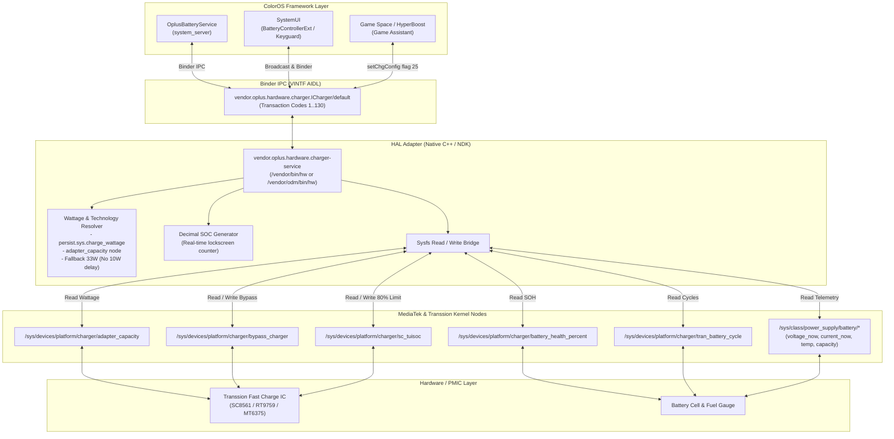

# OPlus Charger AIDL HAL Adapter for Transsion / MediaTek Devices

Custom native AIDL HAL adapter implementing `vendor.oplus.hardware.charger.ICharger` for ColorOS, OxygenOS, and RealmeUI (Android 14+) ported to MediaTek devices (specifically Transsion platforms: Tecno, Infinix, itel running on MT6789 / Helio G99 and Dimensity SoCs).

---

## Overview

Stock ColorOS relies on proprietary OPlus hardware controllers (VOOC MCU / charge pumps) and kernel interfaces (`/dev/oplus_chg`, `/sys/class/oplus_chg/*`). When running ColorOS ports on non-OPlus hardware, the stock charger service fails to read hardware telemetry, causing:

1. Absence of SuperVOOC / VOOC charging animations.
2. Inability to trigger dynamic wattage display (stuck at 10W default USB charging).
3. Non-functional Game Space Bypass Charging.
4. Broken 80% charge protection limit and Battery Health (SOH) reporting.

This HAL bridges standard MediaTek and Transsion hardware kernel sysfs nodes into the official ColorOS AIDL Binder contract, restoring full UI animations, lockscreen decimal counters, and battery management features without modifying framework JAR files.

---

## Architecture Diagram



---

## Implemented Features

### 1. Real SuperVOOC Detection & Dynamic Wattage
* **Accurate Protocol & Wattage Hierarchy:**
  - **Normal / Standard Charging (SDP / CDP / 5V USB <= 10W):** Reports `mChargerTechnology = 0`, `mFastChgType = 0`, `mIsSupSpeedCharge = 0`, and `uiIconType = 1`. SuperVOOC animation is **NOT** triggered on slow USB or generic 5V chargers.
  - **Fast Charging (15W - 27W, e.g. QC/PD/PE 18W):** Reports `mChargerTechnology = 2` (VOOC / Fast), `mFastChgType = 1`, `fastCharge = 1`, and `uiIconType = 1`.
  - **Real SuperVOOC (>= 30W, e.g. 33W, 45W, 68W, 70W, 120W):** Triggered when hardware negotiated capacity is >= 30W or direct charge pump (`primary_dvchg`) is active. Reports `mChargerTechnology = 3`, `mFastChgType = 2`, `mIsSupSpeedCharge = 1`, and `uiIconType = 2`.
* **Hardware Telemetry Sources:**
  1. User property override (`persist.sys.charge_wattage` / `persist.sys.oplus.charge_wattage`).
  2. `/sys/devices/platform/charger/adapter_capacity` (hardware negotiated adapter rating).
  3. `/sys/class/power_supply/tran-auto-test/ta_power` (Transsion travel adapter wattage).
  4. Real-time VBUS (`ADC_Charger_Voltage` >= 8000 mV) & charge pump (`primary_dvchg/present`).
  5. Fallback for standard USB: clean 5V/2A (10W) or real measured power, **without** triggering fake SuperVOOC.

### 2. Lockscreen Decimal Percentage Animation
* Implements `healthd_update_ui_soc_decimal` (code 76).
* Direct integration with Transsion fuel gauge `/sys/class/power_supply/tran-auto-test/ui_soc` for authentic hardware decimal percentage (e.g. `2955` -> `29.55%`).
* Smooth sub-counter fallback during active SuperVOOC charging.

### 3. Bypass Charging (Direct Power Supply)
* Bridges ColorOS Game Space / HyperBoost bypass charging toggles (`setChgConfig` flag 25) directly to `/sys/devices/platform/charger/bypass_charger`.
* When enabled, current bypasses the battery cell to power the motherboard directly, minimizing heat during gaming.

### 4. 80% Battery Protection Limit
* Bridges ColorOS Battery Protection (`setChgConfig` flag 14 / 5) to MediaTek `/sys/devices/platform/charger/sc_tuisoc`.
* Automatically sets kernel target charging limit to 80% when enabled, and restores 100% when disabled.

### 5. Battery Health (SOH) & Cycle Counter
* Maps `/sys/devices/platform/charger/battery_health_percent` to `getUIsohValue` (code 58) and `queryChargeInfo` (code 79).
* Maps `/sys/devices/platform/charger/tran_battery_cycle` to `getChgConfig` flag 20.

---

## AIDL Interface Contract

| Code | Method Name | Payload / Return | Target Sysfs Node / Logic |
| :--- | :--- | :--- | :--- |
| **4** | `getAcType` | `1` (Online) / `0` (Offline) | `/sys/class/power_supply/charger/online` |
| **5** | `getBattAuthenticate` | `1` | Authentic battery verification |
| **6** | `getBattPPSChgIng` | `1` / `0` | PPS / Fast charging state |
| **7** | `getBattPPSChgPower` | Wattage integer (e.g. `33`) | Resolved adapter power |
| **11** | `getBattVoocChgIng` | `1` / `0` | VOOC active state |
| **12** | `getBatteryVoltageNow` | Voltage in mV | `/sys/class/power_supply/battery/voltage_now` |
| **24** | `getFastCharge` | `1` / `0` | Fast charge active state |
| **26** | `getPsyAcOnline` | `1` / `0` | AC charger state |
| **28** | `getPsyBatteryCurrentNow` | Current in mA | `/sys/class/power_supply/battery/current_now` |
| **38** | `getPsyBatteryStatus` | `"Charging"` / `"Discharging"` | `/sys/class/power_supply/battery/status` |
| **39** | `getPsyBatteryTemp` | Tenths of degrees C | `/sys/class/power_supply/battery/temp` |
| **40** | `getPsyChargeTech` | `3` (SVOOC) / `0` | Charging technology identifier |
| **41** | `getPsyFastChgType` | `2` (SVOOC 65W+) / `0` | Fast charge type |
| **58** | `getUIsohValue` | SOH percentage (e.g. `100`) | `/sys/devices/platform/charger/battery_health_percent` |
| **76** | `healthd_update_ui_soc_decimal` | String (e.g. `"48.07"`) | Real-time decimal counter |
| **79** | `queryChargeInfo` | Key-value formatted text | Full ColorOS telemetry contract |
| **127** | `setChgConfig` | Handled flag & string payload | Bypass charging (25) & 80% limit (14, 5) |
| **128** | `getChgConfig` | String result based on flag | Flags: 0 (Tech), 1 (Watt), 6 (Speed), 24 (Bypass), 30 (JSON) |

---

## Build Instructions

### Prerequisites
* Linux environment (x86_64).
* Android NDK r26b or newer with Clang supporting `aarch64-linux-android34-clang`.
* Target architecture: `aarch64` (ARM64), API 34+ (Android 14+), 16KB page-aligned.

### Compilation
```bash
# Clean previous build artifacts
./build.sh clean

# Compile binary and package releases
./build.sh
```

Build outputs are generated in the `out/` directory:
* `vendor.oplus.hardware.charger-service`
* `vendor.oplus.hardware.charger-V1-service` (alias for ODM partition)
* `vendor.oplus.hardware.charger-service.rc`
* `charger_package.zip` / `charger_package.tar.gz`

---

## Installation & Deployment

### Method A: Replacing Stock ODM HAL
For ROMs where the charger HAL resides in the ODM partition:
1. Copy `out/vendor.oplus.hardware.charger-V1-service` to `/vendor/odm/bin/hw/vendor.oplus.hardware.charger-V1-service`.
2. Set permissions: `chmod 0755 /vendor/odm/bin/hw/vendor.oplus.hardware.charger-V1-service`.

### Method B: Standalone Vendor Service
For ROMs using a vendor partition implementation:
1. Copy `out/vendor.oplus.hardware.charger-service` to `/vendor/bin/hw/vendor.oplus.hardware.charger-service`.
2. Copy `out/vendor.oplus.hardware.charger-service.rc` to `/vendor/etc/init/vendor.oplus.hardware.charger-service.rc`.
3. Set permissions:
   * Binary: `chmod 0755`
   * Init script: `chmod 0644`
4. Ensure the following VINTF entry is present in your vendor manifest (`/vendor/etc/vintf/manifest.xml` or fragment `/vendor/etc/vintf/manifest/manifest_oplus_charger.xml`):
   ```xml
   <manifest version="1.0" type="device">
       <hal format="aidl">
           <name>vendor.oplus.hardware.charger</name>
           <version>1</version>
           <fqname>ICharger/default</fqname>
       </hal>
   </manifest>
   ```

---

## Optional Runtime Configuration

To dynamically override the displayed wattage without rebuilding the binary:

```bash
# Set display wattage to 65W
setprop persist.sys.charge_wattage 65

# Alternative legacy property
setprop persist.sys.rianixia.charge-wattage 65
```

To revert to automatic hardware sysfs detection, clear the property:
```bash
setprop persist.sys.charge_wattage ""
```
