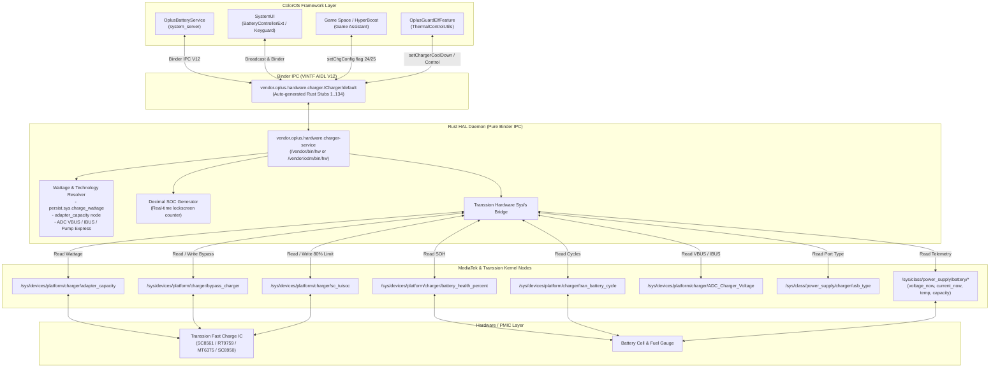

# OPlus Charger AIDL HAL Bridge for Transsion / MediaTek Devices

High-performance Rust AIDL HAL adapter implementing `vendor.oplus.hardware.charger.ICharger` (V12, 134 methods) for ColorOS, OxygenOS, and RealmeUI (Android 14 / 15 / 17+) ported to MediaTek & Transsion devices (specifically Tecno, Infinix, and itel running on MT6789 / Helio G99 and Dimensity SoCs).

---

## Overview

Stock ColorOS relies on proprietary OPlus hardware controllers (VOOC MCU / charge pumps) and kernel interfaces (`/dev/oplus_chg`, `/sys/class/oplus_chg/*`). When running ColorOS ports on non-OPlus hardware, the stock charger service fails to read hardware telemetry, causing:

1. **Absence of SuperVOOC / VOOC charging animations** across lockscreen and notification bar.
2. **Charging clamp or freeze** when plugged into wall chargers due to framework failsafes (`OplusGuardElfFeature: set value = 0`).
3. **USB port misdetection** (e.g. PC connection showing only ADB notification without charging status).
4. **Non-functional Game Space Bypass Charging**.
5. **Broken 80% charge protection limit and Battery Health (SOH) reporting**.

This HAL adapter is written in **memory-safe Rust** utilizing `rsbinder` to directly interface with Android's Binder IPC (`/dev/binder`). It bridges MediaTek / Transsion hardware kernel sysfs nodes into the official ColorOS AIDL V12 Binder contract, restoring full UI animations, lockscreen decimal counters, and battery management features without modifying framework JAR files.

---

## Architecture Diagram



---

## Implemented Features

### 1. Complete AIDL V12 Support (134 Transactions)
* Implements the exact 134-method contract of `vendor.oplus.hardware.charger.ICharger` (V12):
  - Interface Hash: `fe84d18cb5595f64620e559af7f86413aa09a095`
  - Interface Version: `12`
* Implements V12 specific methods:
  - `getDeepSleepClustersSleepWake`: Returns `"0"`, eliminating `RemoteException: Unimplemented` crashes in `OplusBatteryServiceFeature`.
  - `getWirelessTXEnable`: Returns `"disable"` to prevent `wirelessEnable is null` framework errors.
  - `queryRgcpHboostInfo`, `setCV`, `getPowerbankInfo`: Clean stubs with proper parcel status headers.

### 2. SuperVOOC Protocol & Accurate Animation Classification
* **Real SuperVOOC (>= 25W, Dual Charge Pump, or 33W-70W+):**
  - Sets `uiIconType = 3` (ColorOS SuperVOOC animation ring, particles, and lockscreen badge).
  - Sets `mChargerTechnology = 3` (SuperVOOC), `mFastChgType = 2`, `fastCharge = 1`, and `isSupportSpeedCharge = 1`.
  - Dynamically calculates real wattage from negotiated adapter capacity or ADC VBUS/IBUS.
* **VOOC / Fast Charge (15W - 24W, e.g. QC/PD/PE 18W):**
  - Sets `uiIconType = 2` (Green VOOC double bolt icon), `mChargerTechnology = 2`, and `fastCharge = 1`.
* **Standard AC Wall Charging (10W - 12W):**
  - Sets `uiIconType = 1`, `mChargerTechnology = 0`, `fastCharge = 0`, and `usbStatus = 0`.
* **PC USB Port (SDP 500mA):**
  - Accurately detects `[SDP]` from `/sys/class/power_supply/charger/usb_type`.
  - Reports `is_pc_usb = true`, `getPsyUsbOnline = 1`, `getPsyAcOnline = 0`, and `getAcType = 1`.
  - Maintains `usbStatus = 0` (Clean/Dry port) to prevent false liquid/debris alerts (`charge_abnormal_alert_channel_id`, Notification ID 39). Tied to `/sys/devices/platform/charger/Rust_detect`.

### 3. Full ColorOS `Update` JSON Payload (Flag 30)
Provides the full JSON telemetry expected by `OplusBatteryService.getDataFromHalByUpdate`:
```json
{
  "Update": {
    "uiIconType": 3,
    "uiPower": 33,
    "cpaPower": 33,
    "fastCharge": 1,
    "isSupportSpeedCharge": 1,
    "bypassChgStatus": 0,
    "usbStatus": 0,
    "otgOnline": 0,
    "batteryRm": 2500,
    "batteryFcc": 5000,
    "shortIcOtpStatus": 0,
    "shortCHwStatus": 0,
    "notifyCode": 0,
    "bmsStatus": 0,
    "ppsCharging": 0,
    "ppsChargePower": 0
  }
}
```

### 4. Lockscreen Decimal Percentage Animation
* Implements `healthd_update_ui_soc_decimal`.
* Returns comma-separated basis points `{start},{end}` (e.g. `"5014,5022"` for 50.14% -> 50.22%).
* ColorOS SystemUI (`com.oplus.charge.BatteryLevelToDecimalHelper`) divides these values by `100.0f` and interpolates smoothly with `ValueAnimator` over 1000ms.

### 5. Bypass Charging (Game Space Direct Power)
* Bridges ColorOS Game Space / HyperBoost bypass charging toggles (`setChgConfig` flag 24 & 25) directly to `/sys/devices/platform/charger/bypass_charger`.
* Supports flexible command payloads (`"switch=1"`, `"1"`, `"enable"`, `"true"`, `"on"`).
* Bypasses the battery cell to power motherboard components directly, keeping temperatures low during high-load gaming.

### 6. 80% Battery Protection Limit
* Bridges ColorOS Battery Protection (`setChgConfig` flag 5 & 14) to MediaTek `/sys/devices/platform/charger/sc_tuisoc`.
* Automatically sets kernel target charging limit to 80% when enabled, and restores 100% when disabled.

### 7. Battery Health (SOH) & Cycle Counter
* Maps `/sys/devices/platform/charger/battery_health_percent` to `getUIsohValue` and `getChgConfig` flag 58.
* Maps `/sys/devices/platform/charger/tran_battery_cycle` to `getChgConfig` flag 20 and `getPsyBatteryPchgResetCount`.

---

## AIDL Interface Contract

| Method Name | Payload / Return | Target Sysfs Node / Logic |
| :--- | :--- | :--- |
| `getAcType` | `4` (SVOOC) / `3` (VOOC) / `2` (AC) / `1` (USB) / `0` | Port type and fast charge resolution |
| `getBattAuthenticate` | `1` (Authentic) | Authentic battery verification |
| `getBattPPSChgIng` | `1` / `0` | PPS / Fast charging state |
| `getBattPPSChgPower` | Wattage integer (e.g. `33`) | Resolved adapter power |
| `getBattVoocChgIng` | `1` / `0` | SuperVOOC active state |
| `getBatteryVoltageNow` | Voltage in mV | `/sys/class/power_supply/battery/voltage_now` |
| `getFastCharge` | `1` / `0` | Fast charge active state |
| `getPsyAcOnline` | `1` / `0` | AC wall charger online state |
| `getPsyUsbOnline` | `1` / `0` | PC USB port online state |
| `getPsyBatteryCurrentNow`| Current in mA | `/sys/class/power_supply/battery/current_now` |
| `getPsyBatteryStatus` | `"Charging"` / `"Discharging"` | `/sys/class/power_supply/battery/status` |
| `getPsyBatteryTemp` | Tenths of degrees C | `/sys/class/power_supply/battery/temp` |
| `getPsyChargeTech` | `3` (SVOOC) / `2` (VOOC) / `0` (Normal) | Charging technology identifier |
| `getPsyFastChgType` | `2` (SVOOC 65W+) / `1` (VOOC) / `0` | Fast charge type |
| `getUIsohValue` | SOH percentage (e.g. `100`) | `/sys/devices/platform/charger/battery_health_percent` |
| `getDeepSleepClustersSleepWake` | String (`"0"`) | Sleep-wake cluster status (V12) |
| `getWirelessTXEnable` | String (`"disable"`) | Wireless reverse charging guard |
| `healthd_update_ui_soc_decimal` | String (e.g. `"18.25"`) | Real-time decimal counter |
| `queryChargeInfo` | Key-value formatted text | Full ColorOS telemetry contract |
| `setChgConfig` | Handled flag & string payload | Bypass charging (24/25) & 80% limit (5/14) |
| `getChgConfig` | String result based on flag | Flags: 0 (Icon), 1 (Watt), 6 (Speed), 24 (Bypass), 30 (JSON Update), 58 (SOH) |

---

## Build Instructions

### Prerequisites
* Linux environment (x86_64).
* Rust toolchain with target `aarch64-linux-android` (`rustup target add aarch64-linux-android`).
* Android NDK r26b or newer (e.g. `/home/rapli/android-ndk-r26b`).

### Compilation
```bash
# Clean previous build artifacts
./build.sh clean

# Compile optimized release binary
./build.sh release
```

Build outputs in `out/`:
* `vendor.oplus.hardware.charger-service`
* `vendor.oplus.hardware.charger-V1-service` (pre-named for `/vendor/odm/bin/hw/` compatibility)
* `vendor.oplus.hardware.charger-V11-service`
* `vendor.oplus.hardware.charger-V12-service`
* `vendor.oplus.hardware.charger-service.rc`
* `charger_package.tar.gz`

> [!NOTE]
> All binary outputs (`-service`, `-V1-service`, `-V11-service`, `-V12-service`) contain the exact same V12 engine. They are pre-named to match the respective executable names called by your ROM's `/odm/etc/init/*.rc` or `/vendor/etc/init/*.rc` scripts.

---

## Installation & Deployment

### Method 1: Direct File Replacement (Root / TWRP / Terminal)
Check the path referenced by your device's init rc file (`grep -rn 'oplus_charger_hal_service' /vendor/etc/init /odm/etc/init`). For example, on Camon 30 ports:
```bash
# Push binary to target directory
adb push out/vendor.oplus.hardware.charger-V1-service /vendor/odm/bin/hw/vendor.oplus.hardware.charger-V1-service

# Set ownership and executable permissions
adb shell chmod 0755 /vendor/odm/bin/hw/vendor.oplus.hardware.charger-V1-service
adb shell chown root:shell /vendor/odm/bin/hw/vendor.oplus.hardware.charger-V1-service

# Restart the charger HAL service
adb shell stop oplus_charger_hal_service
adb shell start oplus_charger_hal_service
```

### Method 2: Magisk / KernelSU Module
Place the binary inside a Magisk/KSU module replacing the system path:
```text
my_charger_module/
├── module.prop
└── system/
    └── vendor/
        └── odm/
            └── bin/
                └── hw/
                    └── vendor.oplus.hardware.charger-V1-service
```

---

## Optional Runtime Configuration

To dynamically override the displayed wattage without rebuilding the binary:

```bash
# Set display wattage to 65W
setprop persist.sys.charge_wattage 65

# Alternative legacy properties
setprop persist.sys.oplus.charge_wattage 65
setprop persist.sys.rianixia.charge-wattage 65
```

To revert to automatic hardware sysfs detection, clear the property:
```bash
setprop persist.sys.charge_wattage ""
```
